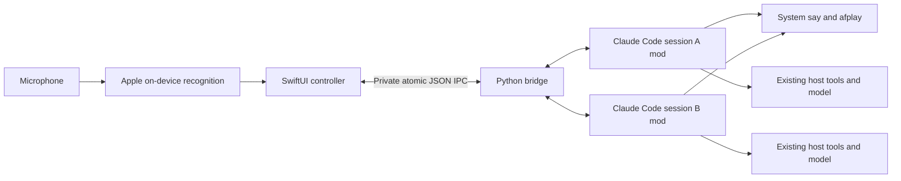

# Architecture

The existing Claude Code process retains authentication, context, tools and permission enforcement. The companion app chooses destinations and handles local speech/UI; it does not possess a separate model API key.

## Main files

| File | Responsibility |
| --- | --- |
| `mod/hooks/register.tsx` | Lifecycle, heartbeat, binding after clear/resume, questions, permissions, queued prompts, speech and acknowledgements |
| `mod/bin/bar.swift` | Session list, presentation, selected destination, captions, demo state, microphone helper ownership and visible controls |
| `mod/bin/VoiceCore.swift` | Parsing, unique-name matching, destination checks, presentation state, audio feedback and endpoint predicates |
| `mod/bin/listen.swift` | Permission flow, raw audio capture, input levels, on-device recognition, playback gate and owner watchdog |
| `mod/bin/Threads.swift` | Project-thread drop inbox, numbered waiting list, the app's own speech queue and the sender hand-off |
| `mod/bin/send.swift` | Separate helper that types one reply into one project thread in the Claude desktop app after verifying the page and reply box |
| `mod/bin/bridge.py` | Atomic files, private permissions, command/response validation, one-time consumption and expiry |
| `mod/bin/session-info.py` | Local session title/identifier discovery |
| `mod/bin/launch-panel.sh` | Respect Quit and avoid reopening an existing controller on session activity |
| `mod/bin/build.sh` | Compile native helpers and sign app bundles locally |
| `scripts/install.py` | Validate/build, snapshot, deploy, Applications links and rollback |

## Delivery and request identity

Session heartbeats keep idle sessions discoverable and expire dead registrations. Each session has an instance identity; clear/resume can rebind it. Selection is explicit, and ambiguous aliases do not resolve silently.

At speech-begin, the controller captures session ID, instance ID and pending request ID. It checks those before processing a final transcript. Commands carry identity and timestamps, expire after 30 seconds, are ordered by submission time, and are consumed once. Queued/started/failed receipts distinguish acceptance from execution. A queued message waits for the current turn to finish; it does not steer a running tool call immediately.

`AskUserQuestion` answers return via the actual tool result. `classic.PermissionRequest` answers are bound to one request. Only explicit approval language can allow it; generic “yes” cannot. Prior host decisions stay authoritative. Error and timeout paths do not approve. This is not a sandbox and voice misrecognition remains a reason to inspect the displayed request before granting permission.

## Audio and ownership

One controller per live/demo state directory is enforced by an OS file lock. Duplicate explicit opens ask the existing controller to show its window. The listener has its own lock and a controller PID owner. Capture requires that owner to be alive; the capture timer exits when it dies.

The recogniser requests on-device processing and has no remote fallback. Raw capture avoids the voice-processing path that stalled the demo. By default, current live playback state or the demo's owned playback marker suppresses recognition; a new recognition task starts when output ends. This is turn-taking, not acoustic echo cancellation. Opt-in headphone interruption lets recognition continue and pauses/stops speech when a begin event arrives. Music and speaker robustness remain unverified.

Endpointing requires stable recognised text for over 0.9 seconds and a quiet gap over 0.6 seconds, or over 1.8 seconds of stable text in continuous noise. Long pauses can split thoughts. The meter measures audio buffer energy; captions use the existing recognition and reply text.

## Local data

`~/.cache/read-aloud/conversation/` stores live session summaries, current spoken text, selected destination, commands, responses, receipts, `voice.log`, latest `audio.json`, locks and the persistent `panel-disabled` marker. `conversation-demo/` isolates simulated traffic and temporary reply audio. These are user-private runtime directories; never commit them. No microphone recording is intentionally saved. Recognition-event logs contain text and are reset when the listener is started.

Live read-aloud renders temporary speech into `/tmp/read-aloud`; the demo renders into its private state directory and removes owned files after playback or Stop. Claude receives recognised text sent to its selected Code session. Existing optional cadence rewrite also uses the session model. This does not make an entire Claude conversation offline.

See [HANDOFF.md](HANDOFF.md) for current limits and [TESTING.md](TESTING.md) before changing these boundaries.
